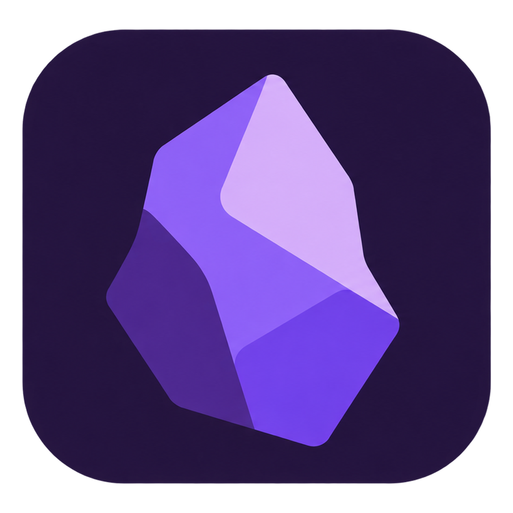

<div align="center">
  

# WebObsidian

**面向桌面与 Android 的本地优先 Markdown 笔记与资料阅读应用**

[下载 Releases](https://github.com/AlexbeatsZ/webobsidian/releases) · [桌面端](desktop/README.md) · [Android 设计与运行](docs/design/android-runtime.md) · [独立同步服务](sync-server/README.md) · [MIT 许可](LICENSE)
</div>

## 项目定位

WebObsidian 基于 [xnohat/webobsidian](https://github.com/xnohat/webobsidian) 继续开发，围绕个人知识库、长篇资料阅读、源码级 Markdown 编辑与原生设备交互重构。

它是 **Windows / macOS / Linux / Android 应用**，不是可独立部署的网站。仓库中的 `web/` 是 Electron 和 Android WebView 共用的 React/CodeMirror 渲染层，`server/` 是随应用启动的本地回环服务；二者不提供独立公网笔记站点，也没有浏览器登录、在线账户或网页托管功能。笔记和附件仍是 Vault 中的普通文件。

## 特色与功能

### Markdown 编辑与知识组织

- **多种编辑视图**：源码、实时预览、阅读模式；标签页、分屏及侧边笔记复用文档会话。
- **原生 Markdown 工作流**：Wiki 链接、反向链接、稳定内容引用、标题大纲、关系图、标签、属性、表格、模板、命令和快捷操作。
- **数学与技术笔记**：MathJax 公式、图表/图示语法、内容锚点以及可配置的写作、格式化规则。
- **可定制界面**：Vault 内的 CSS snippets、菜单及工具配置；部分既有 Obsidian 社区插件由兼容宿主加载。插件并非 100% 兼容，原生 Node/Electron 权限由桌面端单独控制。
- **文件自主权**：文件和资源保持在原文件夹；应用更新不要求迁移 Vault。

### 连续阅读与 PDF

- 原生 PDF 阅读：目录/书签、缩略图、文字层及可见页渲染；Markdown 文档支持大纲与导航。
- **虚拟文档**：以文件夹中的隐藏 `.virtual-document.json` 描述多个 Markdown 或 PDF 文件的阅读顺序，将独立章节呈现为连续滚动的一份资料；支持 Markdown/PDF 分组和统一大纲。
- **阅读连续，编辑独立**：Markdown 章节仍在原文件独立编辑和保存，保留各自 Undo、引用与冲突身份；PDF 按邻近章节/可见页面加载，不把整本书物理拼接成巨大的 Markdown 文件。
- 虚拟文档的具体配置、安全校验和已知边界见 [设计文档](docs/design/virtual-documents.md)。持续开发中的内容以对应源代码和 Release 说明为准，不能用源码状态推断每个平台已发布。

### 同步与 AI

- **可选文件同步**：独立 `sync-server/` 以清单、不可变附件和版本比较同步文件，冲突保留原始内容；另有可选 Git 备份。两者与应用本体分离。
- **本地 MCP 与 AI 编辑审阅**：桌面端内建 MCP 入口，可使用本机 stdio 或配置 Secure MCP Tunnel；文件创建、编辑、重命名等写操作经过本机审阅，避免直接无提示覆盖资料。
- MCP 的权限、可用操作与审阅方式见 [原生 MCP 设计](docs/design/native-mcp.md)。

## 安装与使用

从 [GitHub Releases](https://github.com/AlexbeatsZ/webobsidian/releases) 下载对应平台的 **实际已发布**安装包：

| 平台 | 打包目标 | 说明 |
| --- | --- | --- |
| Windows x64 | NSIS `.exe` 安装程序 | 用户级安装；安装前先退出正在运行的 WebObsidian |
| macOS arm64 / x64 | `.dmg` / `.zip` | 选择与 Apple Silicon / Intel 相符的构建 |
| Linux x64 / arm64 | `.AppImage` / `.deb` | 是否有当前版本文件以 Release 资产为准 |
| Android | `.apk` | 按 Android 文件选择与授权流程打开笔记库 |

首次启动选择或创建 Vault 文件夹。笔记、图片与 Vault 配置不会因卸载应用或升级安装包自动改写。需要跨设备同步时，再按 [同步服务说明](sync-server/README.md) **单独**安装后端并在客户端启用同步；单机使用无需部署服务器。

> **图标说明**：本页展示当前 macOS/Android 风格图标；Windows 使用[专用透明图标](desktop/buildResources/icon-windows.png)，Linux 使用 `desktop/buildResources/icon.png`。旧 `assets/logo.png` 不再是项目主页图标来源。安装包的真实图标由 `desktop/package.json` 和 Android 图标生成脚本确定。

## 从源码构建

需要 Git、**Node.js 20 或更新版本**及 npm；Android 构建还需要对应 Android SDK/JDK 和 Gradle 工具链（参见 [Android 文档](docs/design/android-runtime.md)）。在项目根目录：

```bash
git clone https://github.com/AlexbeatsZ/webobsidian.git
cd webobsidian
npm ci

npm run dev                 # 构建共用渲染层与本地服务，然后启动桌面端
npm run build               # 编译共用核心、渲染层和本地服务
npm run desktop:dist        # 构建本机桌面平台的安装产物
npm run typecheck
npm --workspace desktop run typecheck
npm run test:unit
```

`npm run build` **不会启动浏览器版**。桌面分发还要打包对应架构的 Electron 和指定版本 Secure MCP Tunnel；缺少 GitHub 下载访问时，可按 [桌面构建说明](desktop/README.md) 准备离线缓存。实际构建产物、原生签名、测试与各平台发布进度应分别核对。

## 独立同步服务部署（可选）

同步服务是另行发布的无界面程序，不提供浏览器笔记界面。下载独立的 `sync-server-v*` 发行包，需要 **Node.js 22+**，以独立的配置与数据目录启动：

```bash
node sync-server/server.mjs /absolute/path/to/server.json
```

配置至少包括 `dataDir`、`host`、`port`、`token`；默认仅监听 `127.0.0.1`。公网连接必须经 HTTPS 网关，不应直接暴露未经 TLS 保护的 HTTP 或访问令牌。升级服务端前备份完整数据和操作回执，不能随意重置工作区标识。具体配置样例、启动、回退、备份和冲突处理详见 [sync-server/README.md](sync-server/README.md)。

## 仓库结构

| 路径 | 作用 |
| --- | --- |
| `desktop/` | Electron 宿主、窗口/系统菜单、本机 MCP 生命周期与安装包 |
| `android/` | Android 原生入口、存储选择、内嵌运行时与 WebView |
| `web/` | 共用 CodeMirror/React 编辑与阅读界面 |
| `server/` | 仅供原生应用使用的本机文件、索引和操作服务 |
| `packages/markdown-core/`、`packages/search-core/` | 共用 Markdown 和搜索核心 |
| `sync-server/` | **独立发行**的文件同步后端 |
| `docs/design/` | 组件行为、限制条件与设计依据 |

更多实现信息：[桌面打包](desktop/README.md) · [产品方向](docs/design/product-direction.md) · [原生运行边界](docs/design/native-only.md) · [插件兼容](docs/design/plugin-compatibility.md) · [需求文档](PRD.md)。

## 许可与声明

[MIT License](LICENSE)。基于 `xnohat/webobsidian`，与 Obsidian.md 官方无关联。
